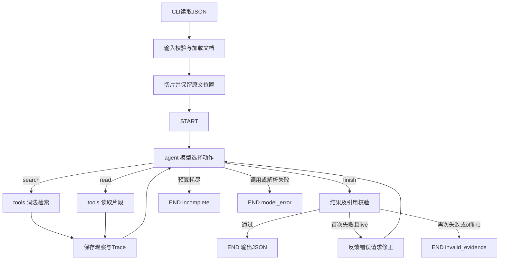

# 企业知识问答 Agent（题目三）

基于 **Python + LangGraph + DeepSeek**，帮助员工查询企业制度。模型根据工具结果选择检索、读取原文、补充查证、追问或结束，最终输出答案、引用、资料缺口、任务状态和执行记录。

当前使用合成JSON文档和本地词法检索。未引入Embedding、Milvus、Elasticsearch或重排序服务，优先验证题目要求的决策、引用和冲突处理。

## 1. 环境与运行

要求Python 3.10+，实际验证环境为Windows、PowerShell、Python 3.12.10。所有命令在仓库根目录执行。

```powershell
python -m venv .venv
.venv\Scripts\python -m pip install -r requirements.txt
# 按已验证环境快照安装时，改用 requirements-lock.txt

# 离线运行：无需密钥
.venv\Scripts\python -m src.main --input examples/conflict.input.json
# 自动化测试：不调用真实模型
.venv\Scripts\python -m unittest discover -s tests -v
```

真实模型模式在根目录创建 `.env`：

```dotenv
LLM_PROVIDER=deepseek
OPENAI_API_KEY=填写自己的密钥
OPENAI_BASE_URL=https://api.deepseek.com/v1
LLM_MODEL=deepseek-chat
LLM_TIMEOUT_SECONDS=30
```

| 配置 | 实现行为 |
|---|---|
| OPENAI_API_KEY | 真实模式必需 |
| OPENAI_BASE_URL | OpenAI兼容地址，由ChatOpenAI读取 |
| LLM_MODEL | 优先模型名 |
| OPENAI_MODEL | LLM_MODEL未设置时使用 |
| LLM_TIMEOUT_SECONDS | SDK请求超时，默认30秒 |
| LLM_PROVIDER | 说明性配置，当前不据此切换适配器 |

只有真实模式自动加载 `.env`，已有环境变量优先。`.env` 已被Git忽略，禁止提交真实密钥。视觉、Embedding及数据库配置当前不参与执行。

```powershell
# 单例真实运行
.venv\Scripts\python -m src.main --mode live --input examples/conflict.input.json
# 九类真实验收：产生模型API费用，更新结果目录
.venv\Scripts\python -m src.evaluate --mode live
```

默认offline模式采用确定性测试替身，只验证流程与校验器；它包含固定场景逻辑，不代表真实模型决策能力，也不保证通过需要语义理解的全部验收。

## 2. 目录与模块职责

```text
.
├── README.md                         # 架构、实现、运行、评审入口
├── requirements.txt                  # 直接依赖范围
├── requirements-lock.txt             # 已验证环境依赖快照
├── .env.example                      # 无真实密钥的配置示例
├── .gitignore
├── data/documents.json               # 默认合成制度
├── src/
│   ├── __init__.py
│   ├── main.py                       # CLI、文件输入、JSON输出、退出码
│   ├── agent.py                      # 状态图、模型协议、工具、引用校验
│   ├── knowledge.py                  # 分块、词项提取、检索评分与排序
│   └── evaluate.py                   # 九类验收、对照语料、输出及指标
├── tests/
│   ├── test_agent.py                 # 基础流程、异常、预算、引用
│   └── test_knowledge.py             # 分片、来源定位、修正、协议
├── examples/
│   ├── *.input.json / *.output.json  # CLI样例及早期离线输出
│   ├── test-results.txt              # 最近一次自动化测试记录
│   ├── acceptance-live/              # 最新九类真实验收
│   │   ├── summary.json              # 通过情况及性能指标
│   │   └── <case>.json               # 输入、完整语料、结果、Trace、检查
│   ├── live/                         # 早期六类真实结果
│   └── 其他历史目录与协议诊断文件    # 包含失败，不作为最新结果
└── docs/
    ├── 01-requirements.md             # 用户、目标、范围、成功标准
    ├── 02-solution.md                 # 流程、动态决策、技术取舍
    ├── 03-evaluation.md               # 实测、失败与验证边界
    ├── 04-ai-usage.md                 # AI辅助及个人贡献待补充项
    └── 05-retrospective.md            # 复盘、限制、下一步
```

## 3. 总体架构与调用链



调用从 `src/main.py:main` 进入 `src/agent.py:run`：校验请求、加载文档、生成片段、选择决策器、构建并编译StateGraph、执行图、返回结果和指标。评估入口直接调用同一run函数，通过documents参数注入对照语料。

图只有agent和tools两个节点。agent的条件边根据动作选择tools、END或反馈修正的agent自身；tools执行后总是返回agent。图提供执行骨架，真实模式中查询内容、读取对象、追问与终止由模型决定。

### 状态设计

| 字段 | 用途 |
|---|---|
| messages | 初始请求、工具动作和观察、可选校验反馈；每轮提供给决策器 |
| action | 当前动作及参数；内部repair仅用于反馈路由 |
| trace | 执行步骤、工具参数、简短依据、返回内容、可选校验错误 |
| steps | 已接收决策次数，用于预算 |
| reads | 以chunk_id索引的已读取原文，作为引用校验依据 |
| result | 最终业务结果或系统失败状态 |

节点返回部分状态；列表通过构造新列表显式追加。每次run创建独立图和状态，无跨请求持久化记忆。历史追问由调用方显式传入history。

## 4. 知识数据、分块与检索

### 4.1 数据格式

`data/documents.json` 为文档数组：

```json
{
  "id": "D01",
  "version_date": "2026-01-01",
  "title": "费用报销制度",
  "text": "员工应在费用发生后30天内提交报销申请。",
  "keywords": ["报销", "费用"]
}
```

默认D01规定30天，D02规定15天，二者故意不提供适用范围和优先级；D03为年假申请规则。D04废止说明仅在resolved验收案例注入，不属于默认资料。

新增资料可编辑JSON，或通过Python调用run时传documents。文档ID应唯一，更新正文应同步更新版本。当前只接收整理好的文本JSON，未实现PDF、Word或图片解析。

### 4.2 分块算法：split_documents

1. 默认按最多240字符切片，从原文位置0依次前进。
2. 原文超过当前块时，优先选择候选区间后半段的最后一个中文句号或换行作为终点。
3. 无适合边界时硬切至240字符；下一块从当前终点继续，无重叠。
4. 保留文档字段，添加doc_id、chunk_id、start、end；片段text严格等于原文[start:end]。

chunk_id形式为 `D01:0-20`。位置是Python Unicode字符索引，左闭右开，不是字节或UTF-16偏移。各块可按序拼接恢复原文。默认三份资料很短，各只有一块；长文切分由自动化测试专门验证。

### 4.3 词法检索：terms与search

去空白并转小写后提取英文数字词和连续中文双字词。每个片段评分为：

```text
theme   = keywords中作为子串出现在query中的关键词个数
lexical = query词项与“片段正文+标题”词项交集的大小
score   = 4 * theme + lexical
```

命中至少一个主题关键词，或lexical至少为2，才进入结果。按分数降序、chunk_id排序，返回文档ID、版本、片段ID、位置、评分、标题和最多80字符摘要。

小语料返回全部命中，避免Top-1隐藏冲突证据。这不是BM25或向量检索；改写理解主要依靠模型生成合适查询。没有Top-K、分页、持久索引或大规模上下文预算。

### 4.4 原文读取：read

ids为字符串数组，优先传搜索返回的chunk_id；也支持文档ID，一次读取其全部片段。输出documents及missing_ids，命中内容写入reads。搜索摘要即使恰好包含完整短文，也不能作为“已读取原文”的依据。

## 5. 模型决策协议与冲突处理

真实模式通过langchain_openai.ChatOpenAI访问兼容接口，temperature为0，启用JSON对象输出模式。每轮发送系统提示和序列化的请求、历史工具观察，没有使用服务商专属函数调用协议。

```json
{"action":"search","query":"报销制度 适用范围 优先级","reason":"查证效力关系"}
```

```json
{"action":"read","ids":["D01:0-20","D02:0-20"],"reason":"核实双方原文"}
```

```json
{
  "action": "finish",
  "reason": "资料不足，需要补充信息",
  "result": {
    "status": "needs_input",
    "answer": "请提供相关制度或适用条件。",
    "citations": [],
    "gaps": ["缺少适用条件"]
  }
}
```

reason仅记录简短、可核验的依据，不要求模型内部思维过程。模型按观察调整行为：

- 有相关资料：读取原文，再回答或继续查证。
- 无命中：改写或补充查询；仍无依据则明确资料缺口。
- 出现冲突：额外检索适用范围、优先级、替代关系；不能仅凭发布日期决定。
- 有明确废止说明：读取并引用说明，结合原制度消解冲突。
- 仍缺适用依据：保留双方冲突并请求用户确认。
- 工具持续失败：有限重试后报告工具错误，不编造答案。

追问通过finish结果返回，不在进程中阻塞等待用户。调用方将新信息放入下一次请求的history；历史只帮助理解语境，不是制度事实来源。

真实路径包括正常 `search→read→finish`、冲突 `search→read→search→finish`、失败 `search→search→finish`。最终以实际Trace为准，修正可能增加步骤。

### 协议容错

模型内容先剥离可选Markdown代码围栏，再由parse_action解析。多个连续合法工具JSON只执行第一个，其他提议丢弃，待工具返回后重新决策；多对象中含finish则拒绝，避免提前采纳没有实际执行工具的结论。

格式失败反馈给模型，最多一次额外生成，再失败返回model_error。原始异常响应记录于protocol_errors，仅供诊断，不代表已执行的动作。

### 执行限制

| 机制 | 实际控制 |
|---|---|
| 决策预算 | max_steps默认10，范围1至30；耗尽返回incomplete |
| 图递归保护 | recursion_limit = 2 * max_steps + 5 |
| 请求超时 | 默认30秒，可配置；不是整个任务的硬超时 |
| SDK重试 | max_retries=1，可能增加实际网络请求 |
| 格式修复 | 每次决策最多一次额外生成 |
| 引用反馈 | 每个真实任务最多一次，消耗决策预算 |
| 不重复调用、无命中最多两次改写、失败最多一次重试 | 提示词要求，非独立硬计数；由总步数兜底 |

steps包括被引用校验拒绝的结束动作；格式修复增加模型调用，不单独增加steps。模型调用异常时不新增成功决策Trace。

## 6. 引用校验

finish首先检查基本结果类型和允许状态，再对每条引用验证：

1. doc_id来自本次已读取片段；如果提供chunk_id，也必须一致。
2. version_date与来源匹配。
3. quote是非空字符串，且完整包含在同一个已读片段中。
4. completed和conflict至少有一条引用。

通过后程序补齐可信chunk_id及quote的start/end，覆盖模型自行填写的位置。同一片段重复出现相同引文时定位首个匹配。

真实模式首次校验失败会反馈“必须先read再引用”，允许模型修正一次，再次失败返回invalid_evidence；离线模式直接返回该状态。

该机制证明引用真实性及可定位性，不能证明答案全部事实在语义上被原文支持，也没有程序强制要求每个冲突答案同时引用双方；这些通过模型提示、验收检查和人工审阅共同评估。

## 7. 输入输出契约

输入示例：

```json
{
  "question": "需要提前多久？",
  "history": ["我想申请年假"],
  "max_steps": 10,
  "simulate_tool_failure": false
}
```

question必须是非空字符串；history可省略，提供时必须是数组；max_steps必须为1至30整数，布尔值不接受。simulate_tool_failure为验收开关，启用后本次所有检索、读取均模拟失败。

| 输出字段 | 含义 |
|---|---|
| status | 业务或系统状态 |
| answer | 答案、追问、冲突或失败说明 |
| citations | 每项含doc_id、version_date、quote、chunk_id、start、end |
| gaps | 缺少资料、待确认条件或错误摘要 |
| mode / verification | 区分live真实运行与offline替身 |
| trace | step、action、parameters、reason、observation及可选validation_error |
| protocol_errors | 异常模型原始响应 |
| metrics | 耗时、决策数、工具数、模型返回数、Token |

| status | 含义 |
|---|---|
| completed | 已给出有引用的答案 |
| conflict | 存在无法消解的资料冲突 |
| needs_input | 需要用户补充信息 |
| insufficient_evidence | 资料不足 |
| tool_error | 工具失败，无法核实 |
| incomplete | 执行预算耗尽 |
| model_error | 模型调用或解析失败 |
| invalid_evidence | 结果未通过格式或引用校验 |
| invalid_input | CLI输入读取、JSON或初始化配置校验失败 |

CLI输出业务JSON时返回退出码0，包括业务失败状态；捕获到ValueError或OSError时输出invalid_input并返回2。评估入口则全部检查通过返回0，否则返回1。

## 8. 性能指标和取舍

| 指标 | 统计口径 |
|---|---|
| elapsed_seconds | run总耗时，含工具、图执行及模型等待 |
| decision_steps | 成功接收的决策数，含引用拒绝后的修正步骤 |
| tool_calls | Trace中search/read次数，包括失败调用 |
| model_responses | SDK成功返回的响应数，含格式修复，不含内部传输重试 |
| total_tokens | usage_metadata.total_tokens累计值，未提供时按0计 |

正常问题读取后直接结束，冲突增加必要查证，引用失败有限修复。没有额外Embedding、重排序API或数据库部署成本。

每轮仍发送累积观察；检索扫描片段并重算词项，没有缓存、压缩和持久索引。当前优化针对题目可靠性与小语料调用效率，不代表大规模吞吐优化。

## 9. 测试与真实验收结果

### 自动化测试

最近16项测试全部通过，见 [test-results.txt](examples/test-results.txt)。覆盖正常/冲突/资料外/改写/历史/失败、预算、替换文档、伪造引用、分片重建、正文检索、未读片段拦截、引用位置、反馈修正和多动作解析。使用离线或注入策略，不发起真实模型请求；live反馈单测也使用注入策略。

### 真实模型验收

2026-11-10最新完整运行，DeepSeek deepseek-chat：9/9项自动检查通过，平均约4.02秒。

| 案例 | 状态 | 关键行为 | 耗时/秒 |
|---|---|---|---:|
| normal | completed | 引用D03，提前3个工作日 | 4.453 |
| conflict | conflict | 30天/15天双方引用，追加查证并追问 | 4.953 |
| missing | insufficient_evidence | 资料外问题补充检索后停止 | 3.235 |
| paraphrase | conflict | 理解“垫付的钱找公司结算” | 7.438 |
| context | completed | 根据历史理解年假追问 | 3.250 |
| tool-failure | tool_error | 工具失败后有限重试 | 2.969 |
| single-source | completed | 只有D01时回答30天 | 3.360 |
| replacement | completed | 原文改45天，答案随之改变 | 3.203 |
| resolved | completed | D04明确废止D02，引用依据适用30天 | 3.312 |

[最新汇总](examples/acceptance-live/summary.json)；同目录每例JSON保存请求、完整语料、实际输出、Trace和检查结果。重跑会覆盖对应文件，需要保留对照时先复制结果目录。

自动检查覆盖状态、来源ID、关键事实、冲突双方数值、追问、冲突后检索及替换后不出现旧期限。人工复核了冲突、替换及废止说明三类答案与引用。它不是完整语义蕴含评估，9/9不代表长期正确率或生产SLA。
